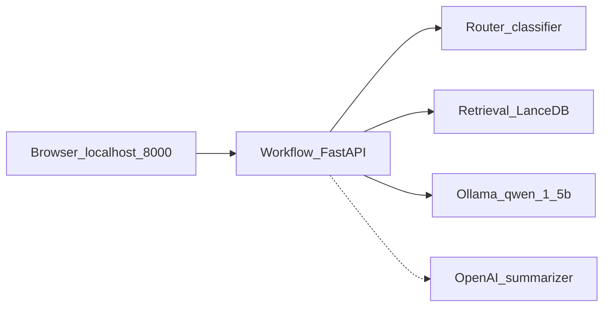

# Week 9 design

Design only. This file is the working plan for Homework 9. It is written so the feature section can later be trimmed into the Task 3 definition. No application code belongs in this step.

## Goal

Turn the Homework 8 four-service deployment into one local app the browser can open, then add one modest feature: replace the small local summarizer with a more capable hosted model.

Part 1 stays on the local model. The hosted model is the feature in Part 2, after the supplied UI has been checked against the existing application.

## Submission layout

Submit one zip, `Fidel_Alejandro_Rosell_Perez_HW9.zip`, with one folder per task that has deliverables:

```text
Fidel_Alejandro_Rosell_Perez_HW9.zip
|-- task1/
|-- task3/
|-- task4/
`-- task5/
```

Task 2 is a browser check and has no folder. Writeups are `.md`. Tables are CSV. Credentials stay out of the zip.

`task1/` must rebuild on a machine that already has the external Docker volume `homework7_ollama`. Record storage and trace storage start empty. Previous homework volumes are left behind by giving the new volumes their own names, `hw9-workflow-traces` and `hw9-record-store`, so an old `workflow-traces` or `record-store` volume is not reused.

## Current system

The running application is the Homework 8 Task 6 workflow plus the Homework 8 Task 3 router and retrieval images.

| Piece | Where it lives today | What it does |
| --- | --- | --- |
| Workflow API | `hw_8/Task6/workflow_api.py` | FastAPI app the UI adapter will import |
| Workflow | `hw_8/Task6/workflow.py` | Routes and summarizes in parallel |
| Local summarizer | `hw_8/Task6/llm_service.py` | Posts to Ollama `/api/chat` |
| Compose | `hw_8/Task6/compose.yaml` | Four services, workflow on port 8000 |
| Router image | `hw_8/Task3/router/` | Classifier, model file under `model/` |
| Retrieval image | `hw_8/Task3/retrieval/` | LanceDB over support-article chunks |
| Embedding model | `BAAI/bge-small-en-v1.5` | Pinned ONNX snapshot baked into the retrieval image |
| Local LLM | `qwen2.5:1.5b-instruct-q4_K_M` | On the `homework7_ollama` volume |
| Metrics | `hw_8/Task6/metrics.py` | `median_workflow_ms`, `workflow_failure_rate`, `routing_review_rate` |
| Sample tickets | `hw_2/Fidel Alejandro Rosell Perez - support_tickets.csv` | Inputs for the demo and the evaluation |

The summarizer returns exactly three fields: `summary`, `customer_request`, and `missing_information`. `workflow.py` checks that shape in `_summary`. The supplied UI checks the same shape in `isWorkflowResult` and rejects anything else. A better model still has to produce that object.

Retrieval returns ranked article chunks with `chunk_id`, distance, content, and metadata. Those chunks are evidence for the summary. They are support articles, and they are separate from the ticket dataset.



The solid path is Task 1. The dashed path replaces only the summarizer in Task 4. Routing and retrieval stay as they are.

## Task 1 — serve the supplied UI

`task1/` is a self-contained copy. The grader runs `docker compose up --build` from that directory and does not depend on `hw_8/` paths.

Copy these into `task1/`:

- The Task 6 workflow files: `workflow_api.py`, `workflow.py`, `routing_client.py`, `retrieval_client.py`, `llm_service.py`, `routing_review.py`, `workflow_record_store.py`, `metrics.py`, `requirements.txt`, `Dockerfile`, `.dockerignore`, `shared/`, and `compose.yaml`.
- `hw_8/Task3/router/` as `task1/router/`, including its Dockerfile, requirements, shared package, and `model/`.
- `hw_8/Task3/retrieval/` as `task1/retrieval/`, including its Dockerfile, requirements, service code, and `data/`.
- `hw_9/ui/` as `task1/ui/` (`index.html`, `app.js`, `styles.css`).
- `hw_9/ui_workflow_api.py` as `task1/ui_workflow_api.py`.

Then make these edits:

1. In `ui_workflow_api.py`, replace the placeholder import with `from workflow_api import app`.
2. In `ui/app.js`, set `METRICS` to `median_workflow_ms`, `workflow_failure_rate`, and `routing_review_rate`. These are suffixes. The UI requests `/ops/metrics/<name>`.
3. In the workflow `Dockerfile`, copy the three UI files to `/app/ui`, copy `ui_workflow_api.py` to `/app`, and change the start command from `workflow_api:app` to `ui_workflow_api:app`.
4. In `compose.yaml`, build the workflow from `.`, the router from `./router`, and retrieval from `./retrieval`. Keep `OLLAMA_URL` at `http://ollama:11434/api/chat`. Mount the external volume `homework7_ollama`. Name the new trace and record volumes `hw9-workflow-traces` and `hw9-record-store`.

The Ollama service, the healthcheck `ollama show qwen2.5:1.5b-instruct-q4_K_M`, and the local model name in `workflow.py` stay. Task 1 does not call OpenAI.

From `task1/`, run `docker compose up --build` and open `http://localhost:8000/`. The page should load before any feature work starts.

## Task 2 — check the UI

Use a ticket body from the Homework 2 CSV. Confirm each of these in the browser. Nothing from this task is submitted.

1. Process Ticket: submit a dataset ticket and wait until the result appears next to the form.
2. Workflow Records: the saved record is listed.
3. Open the record and check that the stored ticket body, summary, department, and evidence match the result.
4. Routing-review and department filters include the ticket when they should and hide it when they should.
5. The department assignment panel is present. The dropdown is red when review is required and white when it is optional. Assigning a department changes the assigned department and leaves the model recommendation in place.
6. Copy the trace id into Operations. One `GET /ops/traces?trace_id=` response shows the Homework 6 service log lines and the Homework 8 monitoring events together, in the order they were recorded.
7. The three metric tiles load. Numbers show at most three decimal places. A missing value shows as `N/A`.

## Feature choice

Choose Option 1, Use a More Capable LLM.

The useful change is the summary a support agent reads. The current model is `qwen2.5:1.5b-instruct-q4_K_M`, a small local instruct model. A hosted general chat model follows the three-field instructions more reliably: it keeps every customer ask, it keeps article text out of the customer's words, and it lists missing details that are actually absent.

Scope stays inside the summarization flow:

- Same ticket body in.
- Same retrieved articles in.
- Same JSON object out, checked by the existing `_summary` function.
- Router, retrieval, record store, routing-review policy, traces, and metrics keep their current behavior.
- The supplied UI needs no new screen. Option 1 does not require a UI change. After the swap, one ticket is processed in the browser so the three summary fields still render.

The other options stay out of this homework. Option 2 searches past tickets. Option 3 adds a retrieval loop. Option 4 draws the workflow graph. Option 5 graphs a metric over time. Option 6 builds a separate LLM router. Option 7 reranks passages. Option 8 mixes keyword and semantic search. Each of those is a different project. The assignment asks for one modest feature.

## Vector database: keep LanceDB

Keep the retrieval service on LanceDB and `BAAI/bge-small-en-v1.5`. Pinecone is out of this homework.

The index stores support-article chunks. Distances and chunk ids already flow into the workflow result and the UI. The summary comparison needs those chunks to stay fixed, so a better summary can be attributed to the model and the prompt. A new vector database would re-embed the knowledge base, change the evidence, and add an account the Task 1 grader does not have. Task 1 has to run from the local retrieval image with only the existing `homework7_ollama` volume.

## Client library: the OpenAI SDK

Call the API with the official `openai` Python package. LangChain stays out of this homework.

`LLMClient` is a small `requests` wrapper around one chat call. The hosted client should be the same kind of object: messages in, a JSON string out. The workflow already owns the system prompt, the user message, and the schema check. LangChain would wrap that single call and add a dependency the rest of the app does not use. There is no agent loop in this feature.

## API access

The call needs an OpenAI API key from platform.openai.com, with a small amount of credit. A ChatGPT Plus, Pro, or Team subscription is the website product. That login does not by itself provide `OPENAI_API_KEY`. Confirm the key works with a one-line API call before building Task 4. If only the website login exists, Option 1 waits until API access is turned on.

Use a current general chat model that supports `json_schema` structured outputs. Leave reasoning models out. A three-field summary does not need them, and they are slower. When implementation starts, pin the exact model slug the account can call, in the GPT-4.1 class or whatever non-reasoning successor is available then, and write that slug in the Task 4 instructions.

## Where the new client plugs in

Add the hosted client beside `LLMClient`. Call it only from `_llm_path` in `workflow.py`. That method already builds the messages, calls the model, times the call, writes the `llm` trace events, and passes the content string to `_summary`.

The hosted call uses the Chat Completions API:

- `messages` stay the system prompt plus the user block that ` _messages` already builds from the ticket body and the article chunks.
- `temperature` is `0`.
- `response_format` is a json_schema whose properties are the existing schema: `summary` (string), `customer_request` (string), `missing_information` (array of strings), all required, no extra properties.
- The response content is still a JSON string. `_summary` parses and rejects it the same way it rejects a bad Ollama reply, so a schema failure still ends as `workflow_failed`.

Gate the choice with an environment variable, `SUMMARIZER`.

- `SUMMARIZER=ollama` uses `LLMClient` and `qwen2.5:1.5b-instruct-q4_K_M`. This is the Task 1 behavior and the baseline for the comparison.
- `SUMMARIZER=openai` uses the hosted client. This is the Task 4 behavior.

Task 1 does not set `SUMMARIZER` and does not include the OpenAI client. Task 4 keeps the Ollama service in Compose so the baseline can be rerun on the same tickets. The workflow image gains the `openai` package only in the Task 4 copy.

`OPENAI_API_KEY` is read from the environment at process start. Compose passes it through from the shell. It is never written into a file, an image, a notebook, or the zip.

## Three prompt rounds

Freeze the evidence first. For each evaluation ticket, call the existing retrieval service once and save the returned chunks. Every model run for that ticket sees those same chunks. The comparison then changes only the model and the prompt.

Use one fixed set of 10 tickets, the first row of each department in `hw_2/Fidel Alejandro Rosell Perez - support_tickets.csv`. The department label is used only to pick the set. It is not sent to the model.

| ticket_id | Department label used to pick the row |
| --- | --- |
| 1 | Technical Support |
| 2 | Returns and Exchanges |
| 3 | Billing and Payments |
| 4 | Sales and Pre-Sales |
| 6 | Service Outages and Maintenance |
| 8 | Product Support |
| 9 | IT Support |
| 12 | Customer Service |
| 18 | Human Resources |
| 31 | General Inquiry |

Run that same set four times: the qwen baseline with the current `SYSTEM` prompt, then three hosted rounds.

Score each output by hand:

- The text is valid JSON with only the three required fields, and both text fields are non-empty.
- `customer_request` includes every request and every question in the ticket.
- `summary` states the reported issue in one or two sentences, with no solution and no department.
- `missing_information` lists only details that are absent from the ticket. An empty list is correct when nothing is clearly missing.
- No sentence from a support article is written as something the customer said.

Rounds:

1. Copy the current `SYSTEM` prompt from `workflow.py` unchanged. This round shows what the model change does by itself.
2. Change the prompt only for the failures found in round 1. The likely failures are article text leaking into the summary, or a second customer question dropped from `customer_request`.
3. Change the prompt only for what round 2 still gets wrong. The likely leftovers are vague missing-information items, or a summary that runs long.

Record, for each round, the full prompt, the 10 outputs, the scores, and the reason for the next edit. Keep the qwen outputs next to them.

## Task 5 demonstration

Save artifacts a reviewer can read without rerunning the API:

- The three prompts.
- A CSV of the scores for qwen and the three rounds, one row per ticket per run.
- The raw summary JSON for each run.
- A short writeup: what improved, what did not, and how the final prompt compares with qwen on the same tickets and the same articles.
- One browser capture of a Task 4 ticket whose summary fields render in the supplied UI.

State one limitation in that writeup. The expected one is cost and an external dependency: the summary now requires a network call and an API key, and the local qwen path remains the one that runs with no account.

## What Task 4 must leave alone

- The router image, the classifier, class scores, and the routing-review rule.
- The retrieval image, LanceDB, the embedding model, and the number of passages passed to the summary.
- Saved-record fields, including the original ticket body.
- Trace events. The `llm` events still record start, completion or failure, `elapsed_ms`, and `missing_count`. They still omit ticket text, summary text, and article text.
- The three metric definitions and `GET /ops/metrics/<name>`.
- The UI contracts the supplied page already calls.

## Order of work

1. Build `task1/` and confirm `http://localhost:8000/` loads on the local model.
2. Walk the Task 2 checklist and fix only integration mistakes.
3. Trim the feature section of this file into `task3/` as the feature definition, and get it approved if the instructor wants that step in writing.
4. In `task4/`, add the hosted client, the `SUMMARIZER` switch, and the winning prompt after the three rounds.
5. In `task5/`, save the prompts, the score CSV, the outputs, the comparison, and the UI capture.
